[← Hasiera](../../index.md) · [Modulua](index.md)

# Inprimaketa (Windows ↔ Linux) 🔄

## Aukerak eta erabakia

| Aukera | Alde onak | Alde txarrak |
|---|---|---|
| **Windows Server inprimaketa-zerbitzaria (Print Server rola)** | Domeinuarekin integratua: AD taldeen baimenak, AD-n argitaratzea, GPO bidezko banaketa; Windows bezeroek driverra zerbitzaritik jasotzen dute | Lizentzia (Windows Server-en barne) |
| **CUPS (Linux)** | Doakoa; IPP estandarra (631); web kudeaketa; Linux eta Windows bezeroentzat | Ez dago AD-rekin integratuta lehenetsiz |
| Inprimagailu bakoitza zuzenean (zerbitzaririk gabe) | Ez da zerbitzaririk behar | Ez dago baimen-kontrolik, ilararik ezta erregistro zentralizaturik |

**Erabakia: biak.** Windows Server-a domeinuko langileentzat (baimenak AD taldeen arabera) eta **CUPS db01-en** Linux ekipoentzat. Bi zerbitzarien arteko proba gurutzatuek erakusten dute sistema eragile desberdinen artean inprimatu daitekeela (errubrika: SEA IE5).

**Inprimagailu fisikorik gabe probatzeko:** Windows-en *Generic / Text Only* driverra **tokiko ataka** batekin (`C:\Imprimaketak\harrera.prn`): lan bakoitza fitxategi batean idazten da eta fitxategia irekita ikusten da nork eta zer inprimatu duen. Linux-en *CUPS-PDF* inprimagailu birtuala (PDF bat lan bakoitzeko).

## Portuak eta protokoloak

| Sistema | Protokoloa | Portua | Erabilera BioHealth-en |
|---|---|---|---|
| Windows | SMB (partekatutako inprimagailuak, `\\zerbitzaria\inprimagailua`) | 445/TCP | Bezeroak `INPR-HARRERA`-ra konektatzeko |
| Windows | RPC (Print Spooler) — *named pipes* (SMB gainean) edo TCP | 135/TCP + dinamikoak | Bezeroa ↔ zerbitzariaren spooler-a |
| Linux (CUPS) | IPP | 631/TCP | db01-eko inprimagailua; CUPS web kudeaketa |
| Sare-inprimagailua | RAW / JetDirect | 9100/TCP | Inprimagailu fisiko baterako (produkzioan) |
| Sare-inprimagailua | LPD | 515/TCP | Inprimagailu zaharretarako |

## Inprimagailuak, kokapena eta baimenak

| Inprimagailua | Kokapena | Zerbitzaria | Ataka / driverra | Baimenak (taldea) |
|---|---|---|---|---|
| `INPR-HARRERA` | Harrera – beheko solairua | `ZERBITZARIPRINT` (192.168.10.1) | `C:\Imprimaketak\harrera.prn` · Generic / Text Only | `harrera`, `administrariak`: Imprimir · `informatika`: Imprimir + Administrar documentos + Administrar impresoras · **Todos kenduta** |
| CUPS-PDF ⏳ | Informatika | `db01` (192.168.10.3) | IPP 631 · CUPS-PDF | ⏳ |

**Zergatik baimen hauek:** harrerak eta administrazioak inprimatzen dute (hitzorduak, fakturak); informatikak inprimagailua kudeatzen du (ilarak, driverrak). Medikuntza eta erizaintza ez dira inprimagailu honetara iristen: **Todos** taldea kendu da, bestela domeinuko edonork inprimatu zezakeen.

## Windows Server: inprimaketa-zerbitzaria ✅

1. Rola: *Servicios de impresión y documentos → Servidor de impresión* (lehendik instalatuta).
2. *Administración de impresión → Servidores de impresión → ZERBITZARIPRINT → Impresoras → Agregar impresora*.
3. *Crear un puerto nuevo → Local Port* → `C:\Imprimaketak\harrera.prn` (karpeta lehenago sortu behar da).
4. Driverra: *Instalar un nuevo controlador → Generic → Generic / Text Only*.
5. Izena eta partekatzea: `INPR-HARRERA`, kokapena eta iruzkina.
6. *Propiedades → Seguridad*: taldeen baimenak (goiko taula).

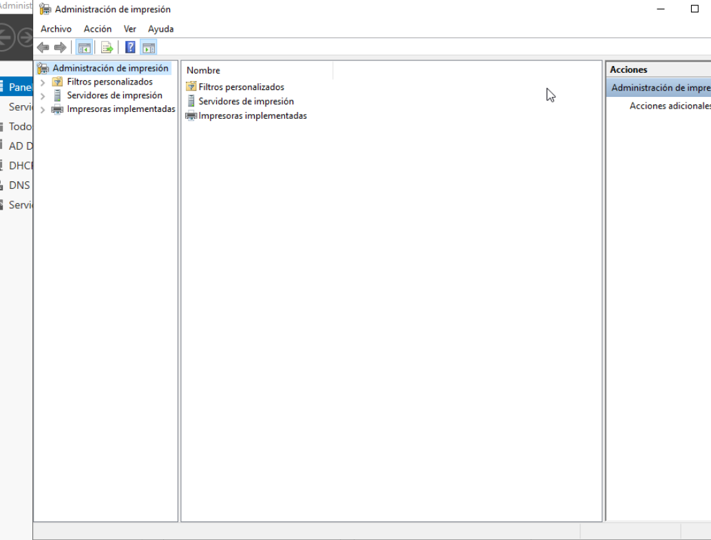
*Irudia: Administración de impresión kontsola (Print Server rola instalatuta).*

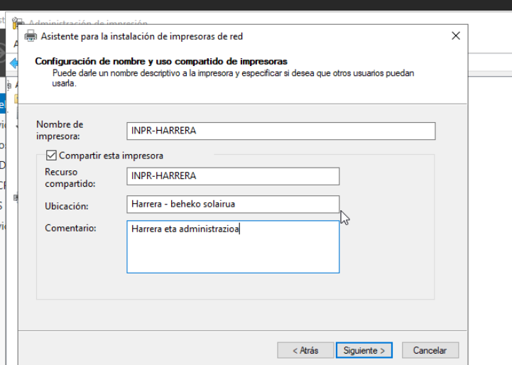
*Irudia: izena, partekatze-izena, kokapena eta iruzkina.*

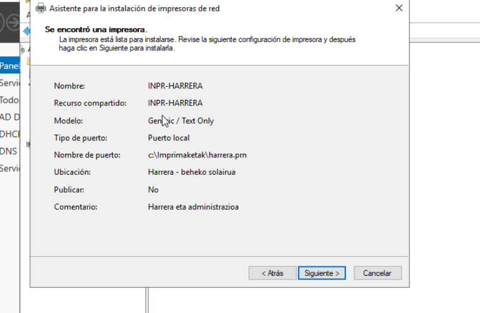
*Irudia: laburpena: Generic / Text Only, tokiko ataka `c:\Imprimaketak\harrera.prn`.*

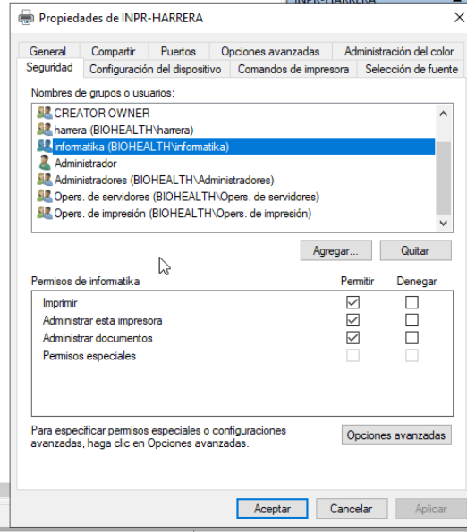
*Irudia: Seguridad fitxa: `harrera` eta `informatika` (Imprimir + Administrar esta impresora + Administrar documentos); **Todos** kenduta. ✅*

### Proba zerbitzaritik bertatik ✅

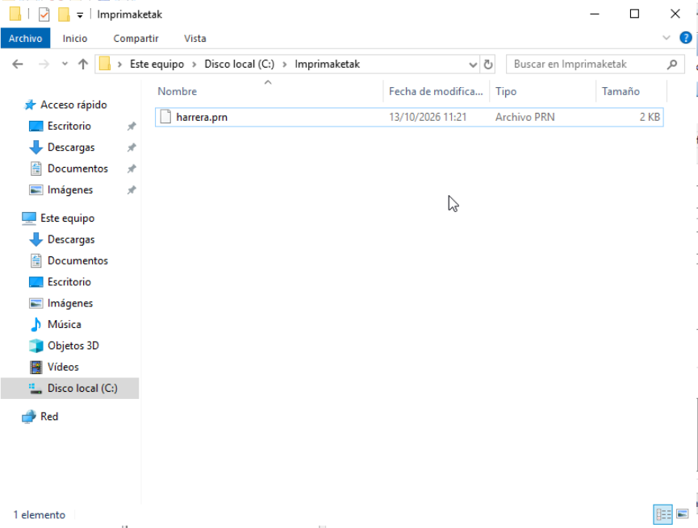
*Irudia: *Imprimir página de prueba* ondoren `C:\Imprimaketak\harrera.prn` sortu da. ✅*

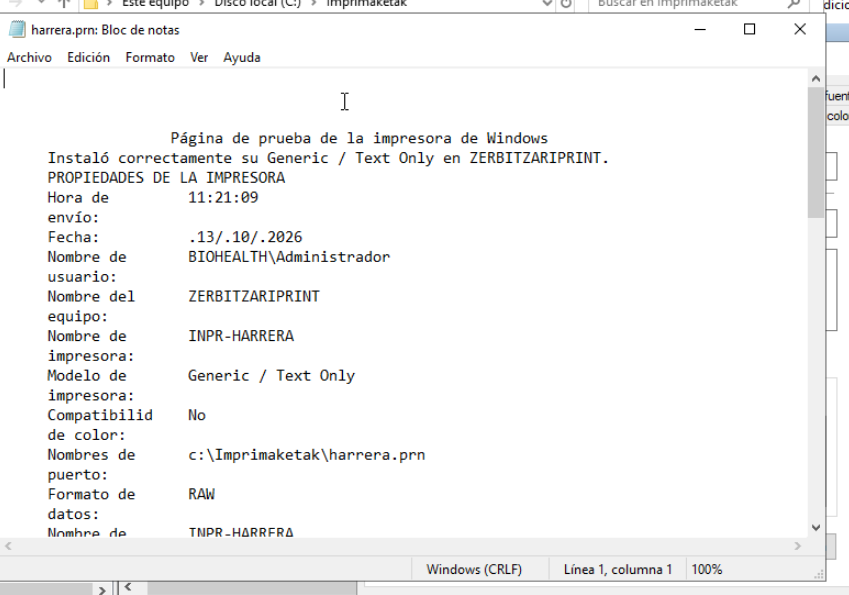
*Irudia: fitxategia Bloc de notas-ekin: «Instaló correctamente su Generic / Text Only en ZERBITZARIPRINT», `BIOHEALTH\Administrador`, `INPR-HARRERA`. Sistema eragilearen berezko tresnekin egiaztatuta. ✅*

## Probak (errubrika)

| # | Proba | Emaitza |
|---|---|---|
| 1 | Windows Server: inprimagailua instalatu eta bertatik proba | ✅ |
| 2 | Windows Server: partekatu domeinuko talde batzuekin | ✅ |
| 3 | Windows bezeroa (BEZ-WIN01, `infor1`) → Windows Server-eko inprimagailua | ✅ |
| 4 | Baimenik gabeko erabiltzailea (`mediku1`) → ukatuta | ⏳ |
| 5 | Linux: CUPS-ekin instalatu eta bertatik proba | ⏳ |
| 6 | Linux: CUPS-ekin sarean partekatu | ⏳ |
| 7 | Linux bezeroa → Linux-eko inprimagailua | ⏳ |
| 8 | Windows → Linux-eko inprimagailua | ⏳ |
| 9 | Linux → Windows Server-eko inprimagailua | ⏳ |

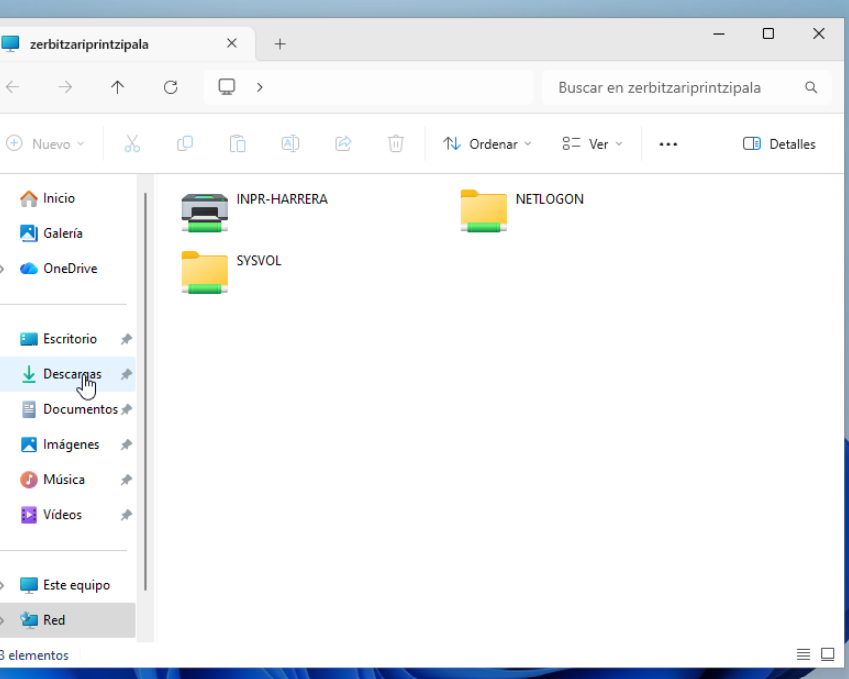
*Irudia: BEZ-WIN01-etik `\\zerbitzariprintzipala`: `INPR-HARRERA` inprimagailu partekatua ikusten da (SMB 445 ✅).*

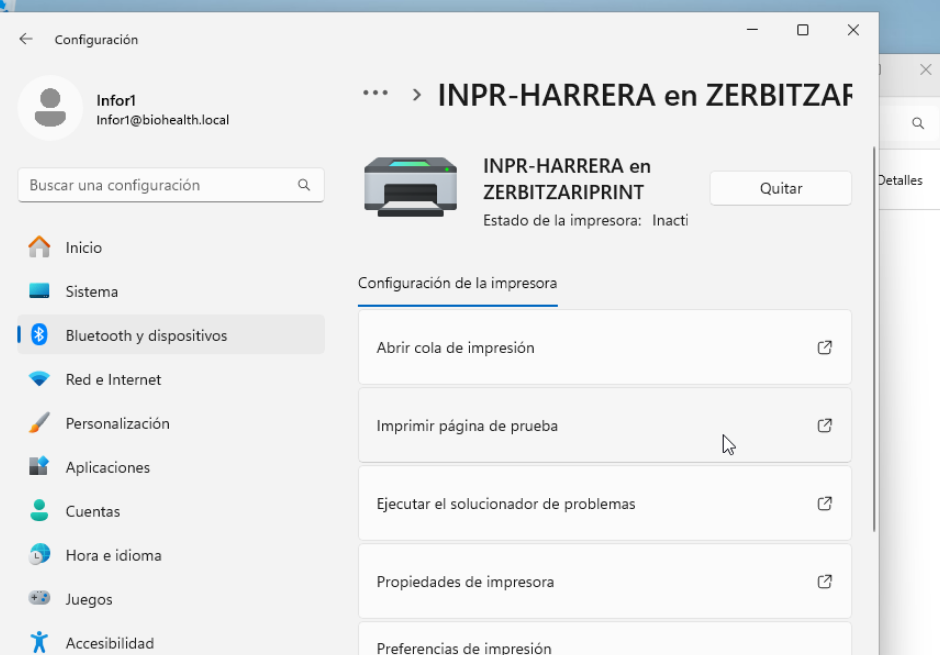
*Irudia: *Agregar manualmente → impresora compartida por nombre* `\\zerbitzariprintzipala\INPR-HARRERA` → «INPR-HARRERA en ZERBITZARIPRINT» instalatuta `infor1`-en saioan. ✅*

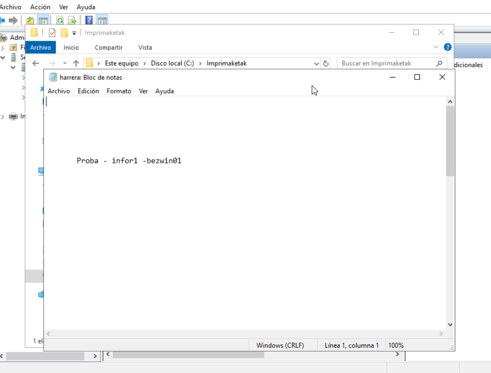
*Irudia: BEZ-WIN01-eko Bloc de notas-etik inprimatutako testua («Proba - infor1 - bezwin01») zerbitzariko `C:\Imprimaketak\harrera.prn` fitxategian. ✅*

## Arazoak

| Arazoa | Kausa | Konponbidea |
|---|---|---|
| Server Manager ez da ireki: «error en un archivo de configuración del usuario… 0x00, carácter no válido» | Erabiltzailearen `user.config` hondatuta, makina bat-batean itzaltzeagatik | *Aceptar* → konfigurazio lehenetsia berreskuratzen du (leihoaren hobespenak bakarrik). Prebentzioa: Windows *Inicio → Apagar* bidez itzali IsardVDI itxi aurretik |
| *Local Port*: «El sistema no puede encontrar la ruta especificada» | Atakaren bidea karpetaren izenarekin bat ez zetorren (`l` / `I` nahastuta; karpeta `Imprimaketak` izenarekin sortuta) | Karpetaren izen zehatza erabili: `C:\Imprimaketak\harrera.prn`. Windows-ek ez du karpeta sortzen, lehenago egon behar du |
| BEZ-WIN01-en inprimagailura konektatzean **0x00000709** | Windows 11 22H2-tik aurrera bezeroak *RPC over TCP* erabiltzen du inprimagailu partekatuetara konektatzeko; Windows Server 2019-ko spooler-ak *named pipes* (SMB) espero ditu | Bezeroak `RpcUseNamedPipeProtocol = 1` behar du. Ezin izan zen bezeroan zuzenean egin: gure **`Panel_Blokeatu` GPOak CMDa blokeatzen du** (eta `Itzali_ez`-ek berrabiaraztea) → GPO bidez egin da (ikus behean) |
| *«Configurar opciones de conexión RPC»* directiva ez da agertzen | Windows Server 2019-ko ADMX txantiloiak zaharragoak dira (directiva Windows 11 22H2-rekin iritsi zen) | **GPO lehentasunak (Preferencias) → Registro** elementua: GPOak erregistro-gakoa idazten du domeinuko ekipo guztietan |
| GPO aplikatu ondoren ere 0x709 | Spooler-a GPOak gakoa idatzi **aurretik** abiarazi zen | Ekipoa itzali eta piztu berriro (IsardVDI-tik) → Spooler-ak gakoa irakurtzen du abiaraztean |
| Bezerotik inprimatzean «Error al imprimir»; ilaran *Error* egoera | Urruneko lanetan spooler-ak **inprimatzen duen erabiltzailearen identitatearekin** idazten du tokiko atakan (`infor1`); erabiltzaile horrek ez zuen `C:\Imprimaketak`-en idazteko baimenik | Karpetari NTFS baimenak: `harrera`, `administrariak`, `informatika` → **Modificar** (inprimagailuaren baimen berdinak). Ilaran *Reiniciar* → ondo inprimatu da |

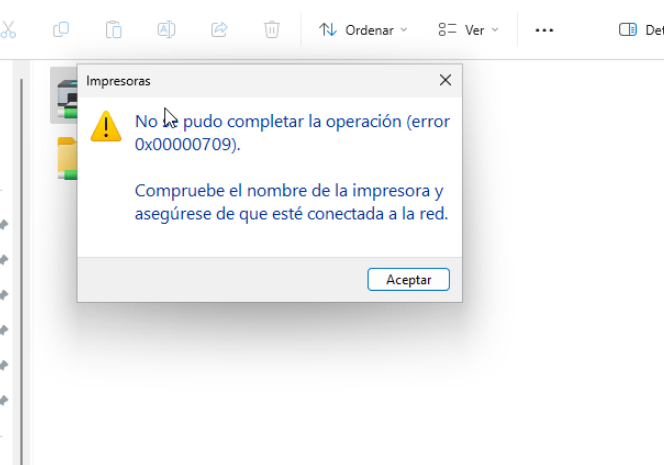
*Irudia: 0x00000709 errorea BEZ-WIN01-en.*

### GPO-Inprimaketa-RPC (0x709-ren konponbidea)

| Ezarpena | Balioa |
|---|---|
| GPO | `GPO-Imprimaketa-RPC`, `biohealth.local` domeinuari lotuta (BEZ-WIN01 *Computers* edukiontzian dago, ez OU batean) |
| Non | *Configuración del equipo → Preferencias → Configuración de Windows → Registro* |
| Elementua | Acción **Actualizar** · `HKEY_LOCAL_MACHINE` · `Software\Policies\Microsoft\Windows NT\Printers\RPC` · `RpcUseNamedPipeProtocol` · `REG_DWORD` = `1` |

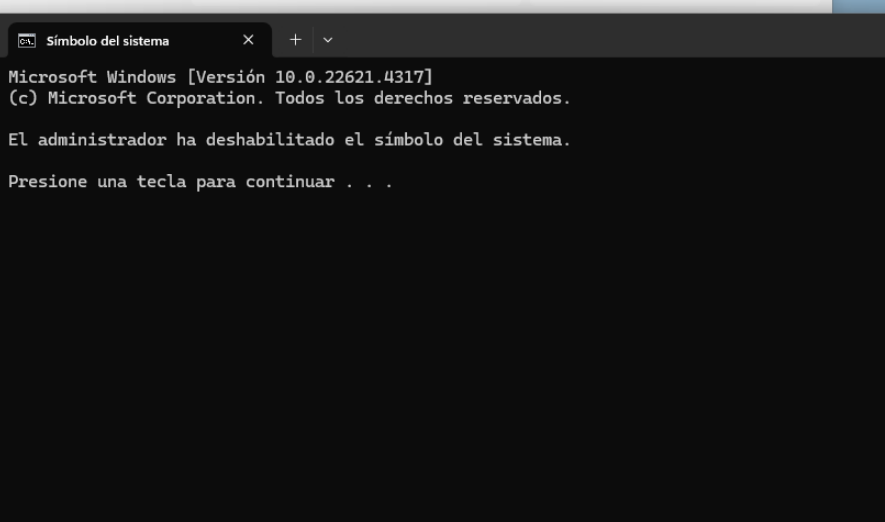
*Irudia: BEZ-WIN01-en CMDa ireki nahian: «El administrador ha deshabilitado el símbolo del sistema» → `Panel_Blokeatu` GPOa funtzionatzen ari da. ✅*

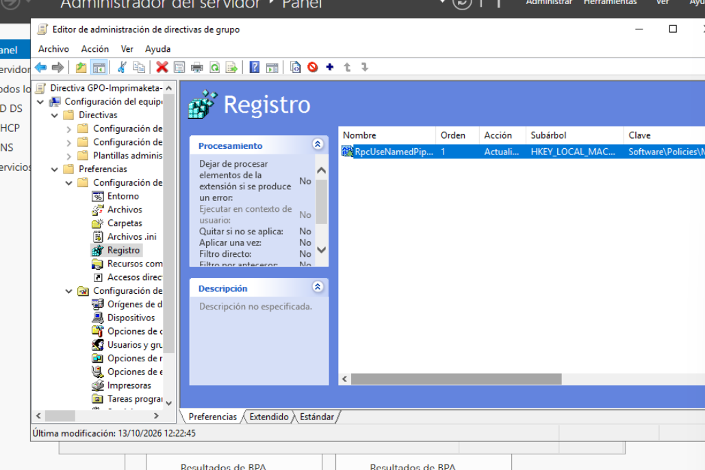
*Irudia: GPOaren erregistro-elementua (Preferencias). Lehen saiakeran bidea gaizki idatzi zen (`WindowsNT`, `Printers` gabe) eta zuzendu egin zen.*

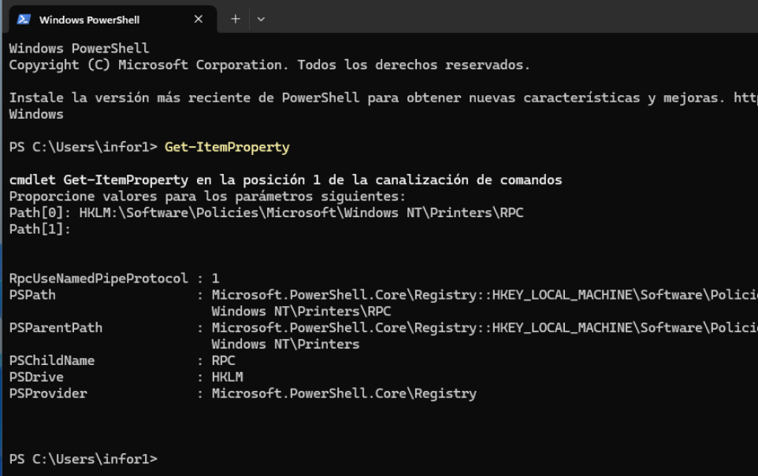
*Irudia: BEZ-WIN01-en PowerShell-ekin egiaztatuta (`Get-ItemProperty`): `RpcUseNamedPipeProtocol : 1` → GPOa bezeroan aplikatu da. ✅*

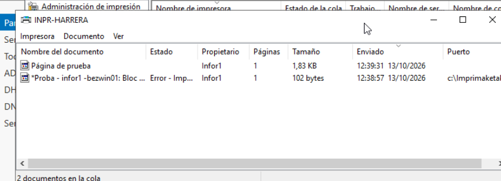
*Irudia: zerbitzariko ilara: `infor1`-en lana «Error - Imprimiendo» egoeran (NTFS baimenak falta ziren).*

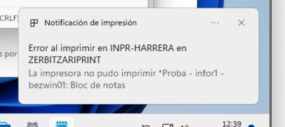
*Irudia: bezeroko jakinarazpena: «La impresora no pudo imprimir».*

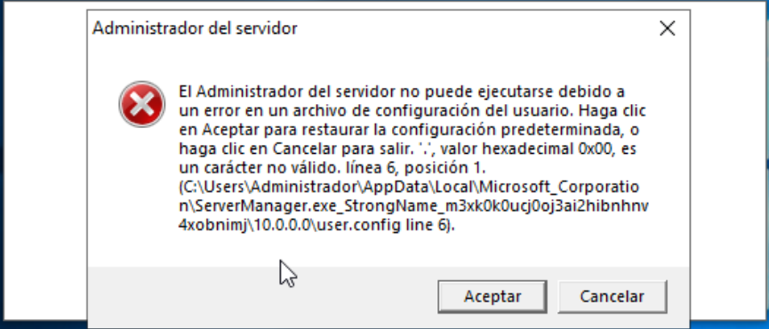
*Irudia: Server Manager-en `user.config` errorea.*
# CUPS Inprimatze-Zerbitzuaren Konfigurazioa eta Saretegia (Dokumentazio Teknikoa)

Dokumentu honek Linux zein Windows inguruneen artean inprimagailuak CUPS (Common Unix Printing System) bidez kudeatzeko eta partekatzeko urrats guztiak biltzen ditu.

---

## 1. Linux: CUPS Instalazioa eta Tokiko Inprimagailuaren Probak

### 1.1. Instalazioa
CUPS zerbitzua eta oinarrizko kontrolatzaileak instalatzeko:

```bash
sudo apt update
sudo apt install cups printer-driver-gutenprint -y
sudo systemctl enable --now cups
```

### 1.2. Erabiltzaile Administratzailea Gehitzea
Inprimagailuak kudeatu ahal izateko, uneko erabiltzailea `lpadmin` taldera gehituko da:

```bash
sudo usermod -aG lpadmin $USER
```

### 1.3. Tokiko Inprimagailua Konfiguratzea eta Proba-Orria Bidaltzea
Web interfazearen bidez (`https://localhost:631`) edo komando-lerrotik inprimagailu birtual/PDF bat konfigura daiteke.

Komando bidez testu-proba bat bidaltzeko:
```bash
echo "Proba testua: Tokiko Linux inprimagailua zuzenean lan eginez." | lp -d Inprimagailu_Izena
```

Edo proba-orri ofiziala bidaltzeko:
```bash
lp -d Inprimagailu_Izena /usr/share/cups/data/testprint
```

> 📸 **ARGAZKI GOMENDAGARRIA (1. atala):** 
> - CUPS web interfazea (`http://localhost:631/printers`) inprimagailua "Idle" / "Ready" egoeran erakusten.
> - Terminalean `lpstat -p` edo `lp` komandoa exekutatzen eta irteera egokia erakusten.

---

## 2. Linux: CUPS Inprimagailua Sarean Partekatzea

Beste gailuek (Linux/Windows) inprimagailua ikusi eta erabili ahal izateko, CUPS-en konfigurazioa aldatu behar da.

### 2.1. `/etc/cups/cupsd.conf` Editatzea

Run komando hau sareko sarbidea baimentzeko:
```bash
sudo cupsctl --share-printers --remote-admin --remote-any
```

Edo eskuz aldatu `/etc/cups/cupsd.conf` fitxategiko atal hauek:

```apache
# Entzun sareko interfaze guztietan (edo IP zehatzean)
Port 631

# Baimendu atzipena barne-saretik
<Location/>
  Order allow,deny
  Allow @LOCAL
</Location>

<Location /admin>
  Order allow,deny
  Allow @LOCAL
</Location>

<Location /printers>
  Order allow,deny
  Allow @LOCAL
</Location>
```

Gorde eta berrabiarazi zerbitzua:
```bash
sudo systemctl restart cups
```

> 📸 **ARGAZKI GOMENDAGARRIA (2. atala):**
> - `/etc/cups/cupsd.conf` fitxategiaren `Allow @LOCAL` zatia edo `cupsctl` exekuzioaren ondorioa.
> - Sareko beste gailu batetik `http://[LINUX_ZERBITZARI_IP]:631` helbidera sartzen dela erakusten duen pantailazoa.

---

## 3. Linux Bezeroa → Linux Zerbitzariko Inprimagailua

Linux bezero batetik zerbitzariko (CUPS) inprimagailua gehitzeko IPP (Internet Printing Protocol) erabiliko dugu.

### 3.1. Inprimagailu Urrunekoa Gehitzeko Urrratsak (GUI edo Komandoa)

**Komando bidez (Bezeroan):**
```bash
sudo lpadmin -p Inprimagailu_Sarekoa -E -v ipp://[ZERBITZARIAREN_IP]:631/printers/Inprimagailu_Izena -m everywhere
```

### 3.2. Proba Testua Bidaltzea
```bash
echo "Proba testua: Linux Bezeroa -> Linux Zerbitzaria (CUPS)" | lp -d Inprimagailu_Sarekoa
```

> 📸 **ARGAZKI GOMENDAGARRIA (3. atala):**
> - Linux bezeroaren ezarpen panela inprimagailu urrunekoa erakusten.
> - Terminalean proba komandoa bidali ondoren `lpstat -o` bidez inprimatze-lanaren egoera ikustea (edo jasotako testu-orria/PDFa).

---

## 4. Windows Bezeroa → Linux Zerbitzariko Inprimagailua

Windows-ek CUPS inprimagailuak jatorriz onartzen ditu IPP protokoloaren bidez.

### 4.1. Gehitzeko Urrratsak Windows-en

1. Ireki **Configuración** > **Bluetooth y dispositivos** > **Impresoras y escáneres**.
2. Egin klik **Agregar dispositivo** botoian eta ondoren **Agregar manualmente**.
3. Hautatu **Seleccionar una impresora compartida por nombre**.
4. Sartu CUPS URL zuzena:
   ```text
   http://[LINUX_ZERBITZARIAREN_IP]:631/printers/Inprimagailu_Izena
   ```
5. Aukeratu kontrolatzailea (*Generic / MS Publisher Imagesetter* edo dagokiona).

### 4.2. Proba Testua Bidaltzea
- Ireki **Bloc de notas (Notepad)**.
- Idatzi testu hau: `Proba testua: Windows Bezeroa -> Linux CUPS Zerbitzaria`.
- Sakatu `Ctrl + P`, hautatu gehitutako inprimagailua eta sakatu **Imprimir**.

> 📸 **ARGAZKI GOMENDAGARRIA (4. atala):**
> - Windows-eko "Agregar impresora por nombre" leihoa IPP URLarekin idatzita.
> - Notepad edo inprimagailuaren propietateetako "Imprimir página de prueba" botoia sakatzean agertzen den baieztapena.

---

## 5. Linux Bezeroa → Windows Server-eko Inprimagailua

Windows Server-en partekatutako inprimagailu batera konektatzeko Linux bidez, SMB (Samba) protokoloa erabiltzen da.

### 5.1. Beharrezko Paketeak Instalatu
```bash
sudo apt install smbclient cups-backend-smb -y
```

### 5.2. Inprimagailua Gehitzeko Urrratsak CUPS-en

**Komando bidez:**
```bash
sudo lpadmin -p Windows_Server_Printer -E -v smb://[ERABILTZAILEA]:[PASAHITZA]@[WINDOWS_SERVER_IP]/[INPRIMAGAILU_IZENA] -m everywhere
```

Edo CUPS Web interfazean (`http://localhost:631`):
1. **Administration** > **Add Printer**.
2. Hautatu **Windows Printer via SAMBA**.
3. Connection URL: `smb://[WINDOWS_SERVER_IP]/[INPRIMAGAILU_IZENA]` (edo domeinu/kredentzialekin `smb://domain\user:password@ip/printer`).

### 5.3. Proba Testua Bidaltzea
```bash
echo "Proba testua: Linux Bezeroa -> Windows Server Inprimagailua (SMB)" | lp -d Windows_Server_Printer
```

> 📸 **ARGAZKI GOMENDAGARRIA (5. atala):**
> - Windows Server-en inprimagailua "Compartida" gisa agertzen den leihoa.
> - Linux-en CUPS interfazea Samba URI-a (`smb://...`) erakusten.
> - Testua bidali ondoren Windows Server-eko "Cola de impresión" (Print Queue) atalean lana sarreran ikusten den unea.
