[← Hasiera](../../index.md) · [Modulua](index.md)

# Suebakia – pfSense

## Aukerak

| Aukera | Alde onak | Alde txarrak |
|---|---|---|
| **pfSense CE** | Doakoa, web GUI, stateful, Suricata eta OpenVPN/WireGuard paketeak; erronkako baliabidea | FreeBSD (Linux ez den sistema) |
| OPNsense | pfSense-ren antzekoa, interfaze modernoa | Klasean ez da landu |
| UFW / nftables | Arina | Zerbitzari bakarra babesten du, ez sare osoa |
| FortiGate | Profesionala | Ordainpekoa |

**Erabakia: pfSense CE** – kostua 0 €, sare osoa babesten du eta IDS + VPN gehitu daitezke makina berean.

## Interfazeak

| Interfazea | Gailua | IP | Oharrak |
|---|---|---|---|
| WAN | vtnet0 | DHCP (IsardVDI Default) | Internetera irteera |
| LAN | vtnet1 | 192.168.10.254/24 | pfSense-ren DHCPa **desgaituta** (Windows Server-ek ematen du) |
| DMZ (OPT1) | vtnet2 (Pertsonala2) | 192.168.20.254/24 | DHCPrik gabe: DMZko zerbitzariek IP finkoa dute ✅ |

Egindakoa:
1. WAN = Default (DHCP), LAN = Pertsonala1 192.168.10.254/24 ✅
2. LAN-eko DHCPa desgaituta ✅
3. Konektibitate-proba: `ping 8.8.8.8` OK ✅
4. IsardVDIn hirugarren sare-txartela gehitu → kontsolan *1) Assign Interfaces*: `vtnet2` = OPT1 → *2) Set interface IP address*: 192.168.20.254/24, DHCPrik gabe ✅
5. Web GUI-n OPT1 → **DMZ** izena ✅
6. `admin` kontuaren pasahitz lehenetsia aldatuta (pfSense-k abisua ematen zuen) ✅

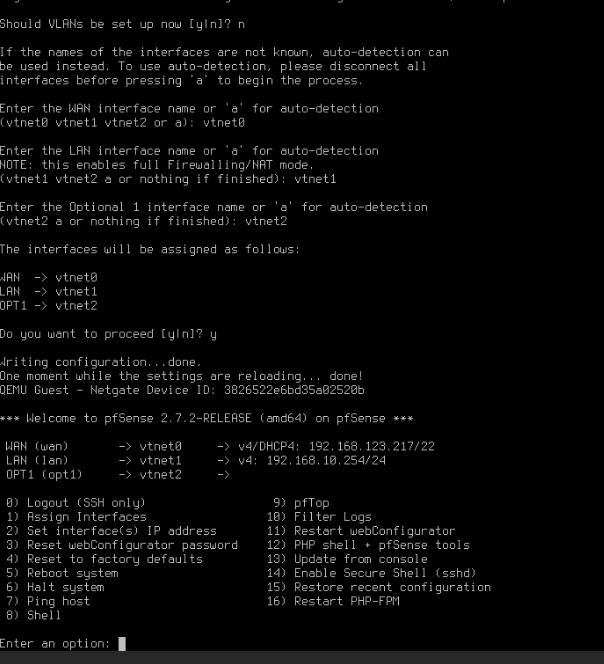
*Irudia: kontsolan interfazeak esleitzen: WAN → vtnet0, LAN → vtnet1, OPT1 → vtnet2.*

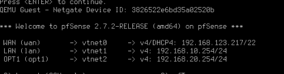
*Irudia: pfSense-ren hiru interfazeak: WAN (DHCP), LAN 192.168.10.254/24 eta OPT1 192.168.20.254/24.*

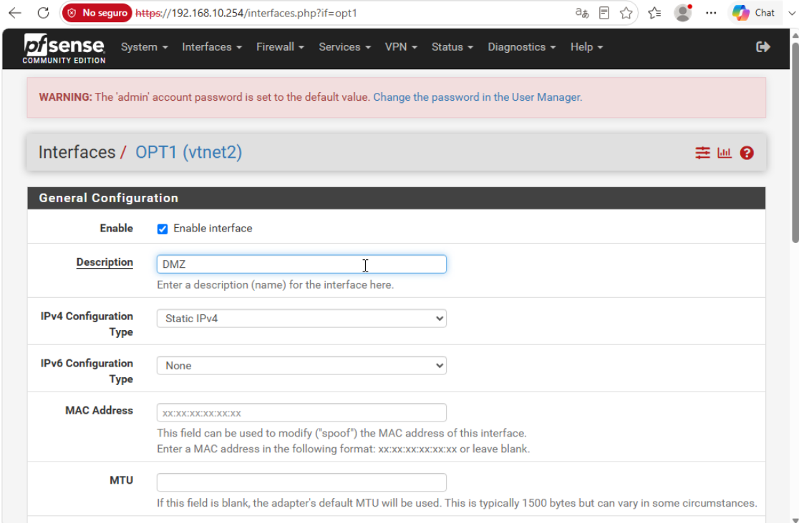
*Irudia: Interfaces → OPT1: gaituta eta «DMZ» deskribapenarekin.*

## Aliasak

Arauak irakurterrazagoak izateko eta IP bat aldatzen bada leku bakarrean aldatzeko, aliasak erabili dira:

| Alias | Mota | Balioa | Deskribapena |
|---|---|---|---|
| `WWW` | Host | 192.168.20.10 | Web zerbitzaria (WordPress + GLPI) |
| `MEET` | Host | 192.168.20.11 | Jitsi Meet |
| `DB01` | Host | 192.168.10.3 | Datu-base zerbitzaria |
| `DC` | Host | 192.168.10.1 | Domeinu-kontrolatzailea (DNS) |
| `WEB_PORTAK` | Port | 80, 443 | HTTP eta HTTPS |

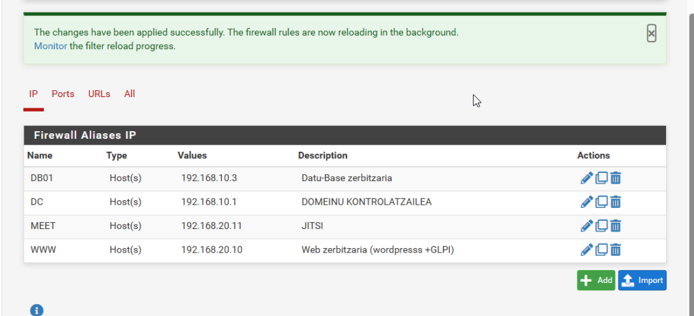
*Irudia: IP aliasak.*

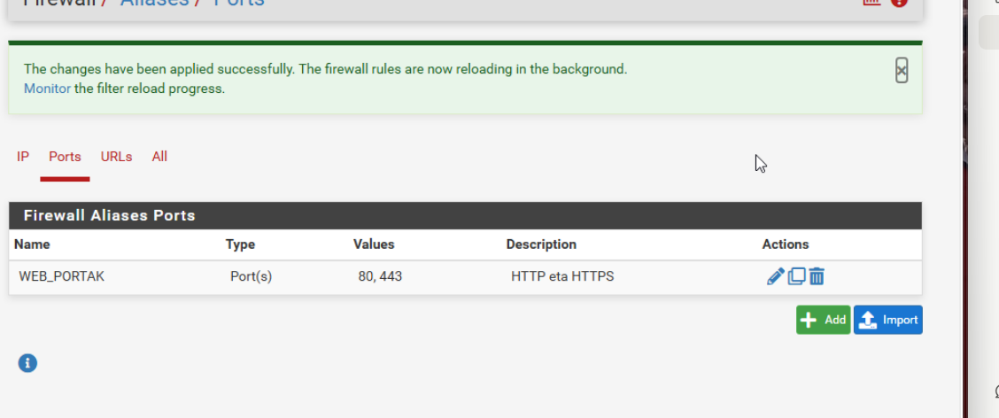
*Irudia: WEB_PORTAK portu aliasa.*

## Arauak

### DMZ interfazea (goitik behera aplikatzen dira; lehen bat datorrenak irabazten du)

| # | Ekintza | Protokoloa | Jatorria | Helburua | Portua | Log | Arrazoia |
|---|---|---|---|---|---|---|---|
| 1 | ✅ Pass | TCP | WWW | DB01 | 3306 | | WordPress-ek eta GLPIk datu-basea behar dute (salbuespena 3. arauaren aurretik) |
| 2 | ✅ Pass | TCP/UDP | DMZ subnets | DC | 53 (DNS) | | DMZko zerbitzariek domeinuko izenak ebatzi |
| 3 | ❌ Block | Any | DMZ subnets | LAN subnets | — | ☑ | DMZko zerbitzari bat erasotzen badute, ezin da LANera iritsi (pazienteen datuak) |
| 4 | ✅ Pass | UDP | DMZ subnets | This Firewall | 123 (NTP) | | DMZko zerbitzariek ordua pfSense-tik hartzen dute (logetan NTP blokeoak aurkitu ondoren gehitua; ikus «Suebakiaren logak») |
| 5 | ❌ Block | Any | DMZ subnets | This Firewall | — | ☑ | DMZtik pfSense-ren kudeaketa-webera (192.168.20.254:443) sarbidea ukatu; bestela 6. arauak baimenduko luke |
| 6 | ✅ Pass | TCP | DMZ subnets | any | WEB_PORTAK | | Eguneraketak (`apt`) eta kanpoko webguneak; LAN eta pfSense aurreko arauek blokeatu dituzte → Internet bakarrik |
| — | ❌ (inplizitua) | | | | | | Baimendu ez den guztia ukatuta (pfSense-ren lehenetsitako portaera) |

**Aldaketak proposamenarekiko:** LDAPS araua (meet → DC 636) ez da sortu, Jitsi-k oraindik ez duelako ADrekin autentifikatzen (sortuko da hori konfiguratzen bada); 5. araua (pfSense blokeoa) gehitu da, diseinua berrikustean pfSense-ren kudeaketa DMZtik irekita geratzen zela ikusi zelako.

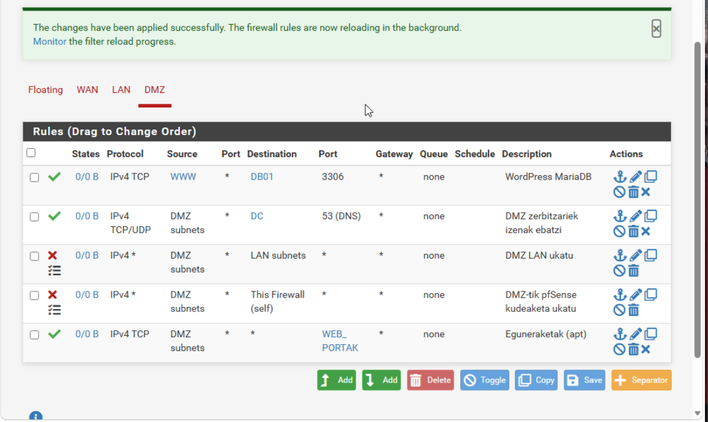
*Irudia: DMZ interfazearen lehen 5 arauak. Block arauek (✖) log-a gaituta dute (☰ ikonoa).*

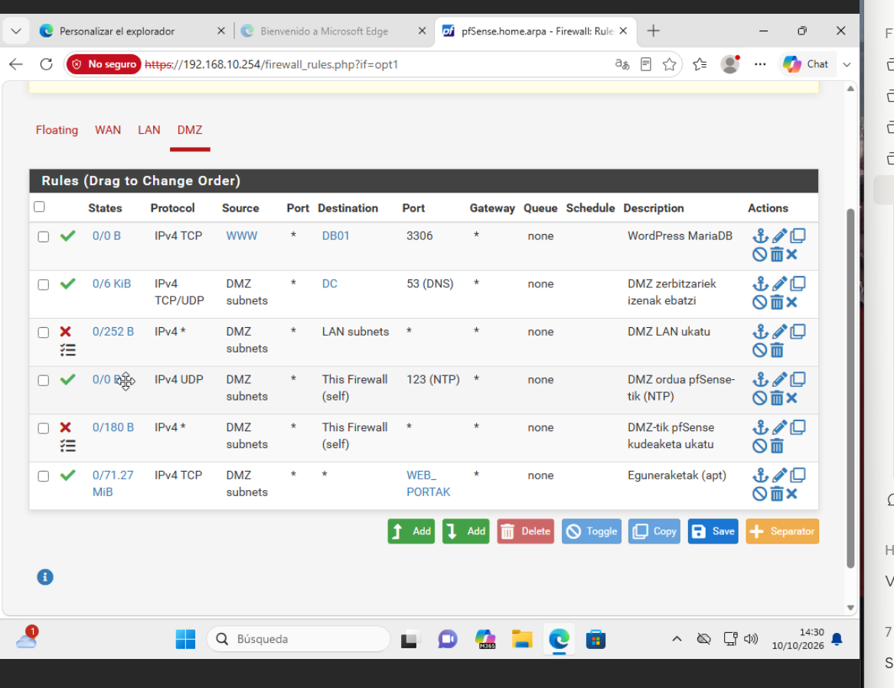
*Irudia: azken bertsioa (6 arau): NTP araua pfSense-ren blokeoaren **gainean** kokatu da, bestela blokeoak lehenago bat egingo luke. States zutabean ikusten da arauek trafikoa jasotzen dutela (DNS 6 KiB, eguneraketak 71 MiB, blokeoak 252 B / 180 B).*

### WAN (NAT – port forward)

| Kanpoko portua | Barneko helburua | Arrazoia |
|---|---|---|
| 443/TCP | www 192.168.20.10 | Web korporatiboa |
| 443/TCP (beste IP/portu bat) | meet 192.168.20.11 | Telekontsulta |
| 10000/UDP | meet 192.168.20.11 | Jitsi audio/bideoa (SRTP) |
| 1194/UDP | pfSense bera (OpenVPN) | Langileen urruneko sarbidea ([VPN](#vpn--urruneko-sarbidea)) — NATik gabe, WAN araua |

> IsardVDIn ezin da Internetetik benetako proba egin; NATa konfiguratu eta argazkia ateratzen da, muga hori azalduz.

## IDS – Suricata

### Aukerak

| Aukera | Alde onak | Alde txarrak |
|---|---|---|
| **Suricata (pfSense paketea)** | Pakete ofiziala, GUI-tik kudeatzen da; multihari; ET Open arauak doan; IDS eta IPS moduak | RAM gehiago behar du (~1–2 GB) |
| Snort (pfSense paketea) | Klasikoa, dokumentazio asko | Hari bakarra; arau onenak (Talos) ordainpekoak edo 30 egun beranduago |
| Zeek (Security Onion) | Analisi sakona | Makina berezi bat eta 16 GB+ RAM; gehiegizkoa |
| Host IDS bakarrik (fail2ban) | Arina | Zerbitzari bakoitza bakarrik; sarearen trafikoa ez du ikusten |

**Erabakia: Suricata pfSense-n, IDS moduan** (detektatu eta logetan erregistratu, ez blokeatu).
- pfSense-k sareko trafiko guztia ikusten du (ertza) → leku bakarrean IDS bakarra.
- **IDS eta ez IPS:** positibo faltsu batek telekontsulta (10000/UDP) edo web-a blokeatuko luke; lehenik alertak ikasi eta doitu, gero IPS (*Inline*) moduan jarri daiteke.
- Interfazeak: **WAN** (kanpoko erasoak) eta **DMZ** (Internetera irekitako zerbitzariak; www edo meet erasotuta badaude, hemen ikusten da). LAN-a ez, lehenengo fasean RAMa aurrezteko.
- Arauak: **ET Open** (Emerging Threats, doakoak, egunero eguneratuak).

### Konfigurazioa

| Urratsa | Non | Balioa |
|---|---|---|
| 0 | IsardVDI → pfSense makina | RAM **2 GB** (Suricata-k 1 GB-rekin huts egin dezake) |
| 1 | *System → Package Manager → Available Packages* | `suricata` → **Install** |
| 2 | *Services → Suricata → Global Settings* | ☑ *Install ETOpen Emerging Threats rules* · *Update Interval*: 12 h · **Save** |
| 3 | *Services → Suricata → Updates* | **Update** → ET Open arauak deskargatuta (data eta MD5) |
| 4 | *Interfaces → Add* | Interface **WAN** · ☑ Enable · ☐ *Block Offenders* (IDS modua) · ☑ *Send Alerts to System Log* · **Save** |
| 5 | *WAN Categories* | `emerging-scan`, `emerging-exploit`, `emerging-attack_response`, `emerging-web_server`, `emerging-sql`, `emerging-dos`, `emerging-malware` · **Save** |
| 6 | *Interfaces → Add* | Interface **DMZ**, 4.–5. urratsen berdina |
| 7 | *Interfaces* | Interfaze bakoitzaren ▶ (Start) → egoera berdea |

### Probak ⏳

| # | Nondik | Komandoa | Espero den alerta (*Services → Suricata → Alerts*) |
|---|---|---|---|
| 1 | www (DMZ) | `curl http://testmynids.org/uid/index.html` | `GPL ATTACK_RESPONSE id check returned root` (DMZ interfazea) |
| 2 | db01 edo bez-lnx01 (LAN → DMZ, pfSense zeharkatzen du) | `sudo apt install -y nmap` → `sudo nmap -sV -p 80,443 192.168.20.10` | `ET SCAN Possible Nmap User-Agent Observed` (DMZ interfazea) |
| 3 | db01 edo bez-lnx01 (LAN) | `curl -A "sqlmap/1.7" "http://192.168.20.10/?id=1%27%20OR%20%271%27=%271"` | `ET SCAN` (sqlmap User-Agent) edo `ET WEB_SERVER` SQL injekzio alerta |

1\. probak ez du ezer arriskutsurik egiten: web-orriak `uid=0(root)` testua itzultzen du, eta arau batek testu hori «root baimenak lortu dituen erasotzaile baten erantzuna» bezala detektatzen du.

**Ebidentziak:** paketea instalatuta · Global Settings · Updates (arauen data) · bi interfazeak martxan · Alerts fitxa 3 proben alertekin · *Status → System Logs* (Suricata alertak sistemaren logean).

## VPN – urruneko sarbidea

### Aukerak

| Aukera | Alde onak | Alde txarrak |
|---|---|---|
| **OpenVPN (pfSense)** | pfSense-n integratua; **wizard**-a eta *Client Export* (`.ovpn` edo Windows instalatzailea); ziurtagiriak + pasahitza; TCP/UDP | WireGuard baino motelagoa |
| WireGuard | Oso azkarra, konfigurazio laburra | pfSense-n pakete gehigarria, wizard-ik eta ziurtagiri-kudeaketarik gabe; erabiltzaile-autentifikaziorik ez (gakoak bakarrik) |
| IPsec (IKEv2) | Estandarra, Windows-ek jatorriz du | Konfigurazio konplexua; NAT-arekin arazoak |
| Urruneko mahaigaina zuzenean (RDP portua ireki) | Erraza | **Arriskutsua**: RDP Internetera irekita, ransomwarearen sarbide nagusia |

**Erabakia: OpenVPN**, *Remote Access (SSL/TLS + User Auth)*: erabiltzaileak **ziurtagiria** (zerbait duena) **eta pasahitza** (zerbait dakiena) behar ditu → bi faktore. Medikuek etxetik telekontsulta edo historia klinikoak kontsultatu behar dituztenean erabiltzen da; BioHealth-eko barne-zerbitzuak ez dira inoiz zuzenean Internetera irekitzen.

**Autentifikazioa:** laborategian *Local User Access* (pfSense-ko erabiltzaileak). Hobekuntza: *System → User Manager → Authentication Servers* → LDAP (`192.168.10.1`, `DC=biohealth,DC=local`) eta wizard-ean *LDAP* aukeratu, langileak ADko kontuarekin sartzeko.

### Ingurunea

| Parametroa | Balioa |
|---|---|
| Zerbitzaria | pfSense, **WAN** interfazea |
| Protokoloa / portua | UDP **1194** |
| Tunel-sarea | `10.0.8.0/24` |
| Sare lokala (bezeroari ematen zaiona) | `192.168.10.0/24` (LAN) |
| DNS bezeroarentzat | `192.168.10.1` (DC) |
| Zifraketa | AES-256-GCM · TLS gakoa · SHA256 |
| CA / zerbitzariaren ziurtagiria | `BioHealth-CA` · `BioHealth-VPN-Server` (2048 bit) |

### Konfigurazioa (OpenVPN Wizard)

1. *VPN → OpenVPN → Wizards*. **Type of Server:** `Local User Access` → Next.

2. **CA sortu:** `BioHealth-CA`, 2048 bit, sha256.
3. **Zerbitzariaren ziurtagiria:** `BioHealth-VPN-Server`, 2048 bit.

4. **Zerbitzariaren parametroak:** Interface `WAN` · `UDP on IPv4 only` · port `1194` · ☑ *Use a TLS Key* · `AES-256-GCM` · tunel-sarea `10.0.8.0/24` · sare lokala `192.168.10.0/24` · DNS `192.168.10.1` · konexio aldiberekoak 10.

5. **Suebaki-arauak** (wizard-ak sortzen ditu):
   - *Firewall Rule*: WAN-en UDP 1194 sarrera baimendu.
   - *OpenVPN rule*: tuneletik LANera trafikoa baimendu.

> **Hobekuntza (pribilegio minimoa):** wizard-ak OpenVPN fitxan «any → any» araua sortzen du. Produkzioan behar dena bakarrik utziko litzateke: DNS (53) eta RDP (3389) DCra, HTTPS (443) www/glpi-ra.

### Erabiltzaileak eta ziurtagiriak

1. *System → User Manager → Add*: `mediku1`, pasahitz sendoa.
2. ☑ *Click to create a user certificate* → izena `mediku1-VPN-Cert`, CA `BioHealth-CA` → **Save**.

### Bezeroaren profila esportatu (Client Export)

1. *System → Package Manager → Available Packages* → `openvpn-client-export` → Install.
2. *VPN → OpenVPN → Client Export* → *Remote Access Server*: `BioHealth-VPN-Server UDP4:1194`.
3. `mediku1` erabiltzailearen lerroan: *Windows Installer* edo *Most Clients* (`.ovpn`).

### Probak ⏳

Bezeroak **WAN aldean** egon behar du (etxetik sartzen den langilea simulatzeko): IsardVDIn **Default** sarean bakarrik dagoen mahaigain bat (Windows edo Ubuntu).

| # | Proba | Espero dena |
|---|---|---|
| 0 | pfSense → *Interfaces → WAN* → ☐ **Block private networks** (IsardVDIko Default sarea helbide pribatuak dira) | Bestela pfSense-k bezeroaren paketeak WAN-en botatzen ditu |
| 1 | Bezeroan OpenVPN GUI / OpenVPN Connect + `.ovpn` → `mediku1` + pasahitza | *Connected* |
| 2 | `ipconfig` / `ip a` | Tunel-interfazea `10.0.8.x` |
| 3 | `ping 192.168.10.1` · `nslookup db01.biohealth.local 192.168.10.1` | ✅ LANera iristen da tuneletik |
| 4 | VPN deskonektatuta: `ping 192.168.10.1` | ❌ ez da iristen (LANa ez dago Internetera irekita) |
| 5 | pfSense: *Status → OpenVPN* eta *Status → System Logs → OpenVPN* | `mediku1` konektatuta, IP birtuala eta jatorrizko IPa |
| 6 | Pasahitz okerra | ❌ `AUTH_FAILED` logean |

## Probak (www-tik, 192.168.20.10)

| Araua | Proba | Espero dena | Emaitza |
|---|---|---|---|
| 2 – DNS | `nslookup db01.biohealth.local 192.168.10.1` | ✅ ebazten da | ✅ `Address: 192.168.10.3` |
| 6 – web irteera | `sudo apt update` | ✅ deskargatzen du | ✅ 21,1 MB es.archive.ubuntu.com-etik |
| 3 – DMZ → LAN | `ping -c 3 192.168.10.1` | ❌ blokeatuta | ✅ `100% packet loss` |
| 5 – DMZ → pfSense | `curl -k -m 5 https://192.168.20.254` | ❌ blokeatuta | ✅ `Connection timed out` |
| inplizitua | `ping -c 3 8.8.8.8` (ICMP Internetera) | ❌ baimendu gabe | ✅ `100% packet loss` |
| 1 – www → db01:3306 | `nc -zv 192.168.10.3 3306` | ✅ | ✅ `succeeded` (db01-en ufw-an ere 3306 www-ri ireki ondoren; ikus [DBKSA](../DBKSA-datu-baseak/datu-baseak.md)) |

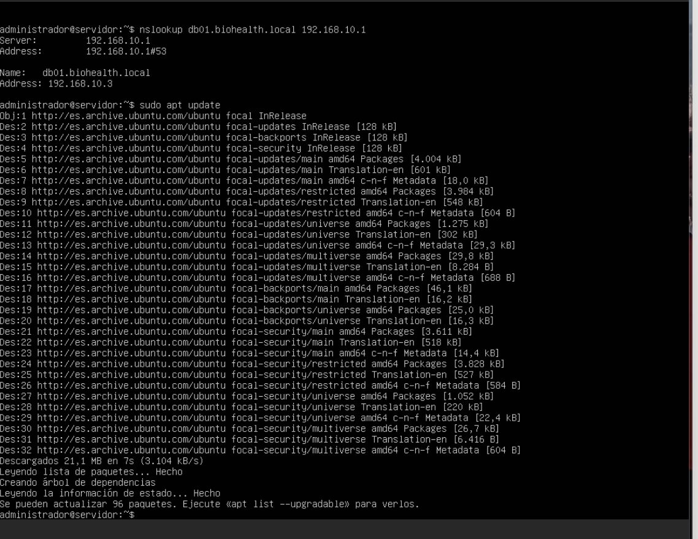
*Irudia: DMZtik domeinuko izenak ebazten dira DCaren bidez (2. araua) eta `apt update`-ek Internetetik deskargatzen du 80 portutik (6. araua). ✅*

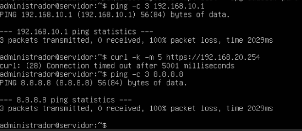
*Irudia: DMZtik LANera (DC, 192.168.10.1) ping-ak huts egiten du (3. araua), pfSense-ren kudeaketa-webera ezin da sartu (5. araua) eta baimendu gabeko trafikoa (ICMP Internetera) ukatuta dago (arau inplizitua). ✅*

### Suebakiaren logak

*Status → System Logs → Firewall* → iragazkia: Source IP `192.168.20.10`

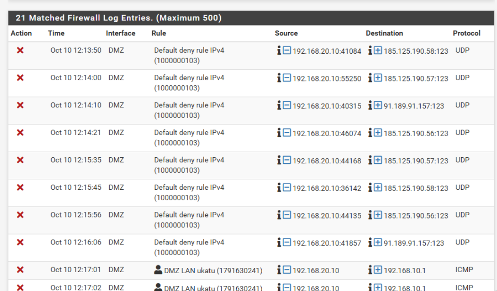
*Irudia: www-ren ping-ak DCra **«DMZ LAN ukatu»** arauak blokeatuta (ICMP → 192.168.10.1).*

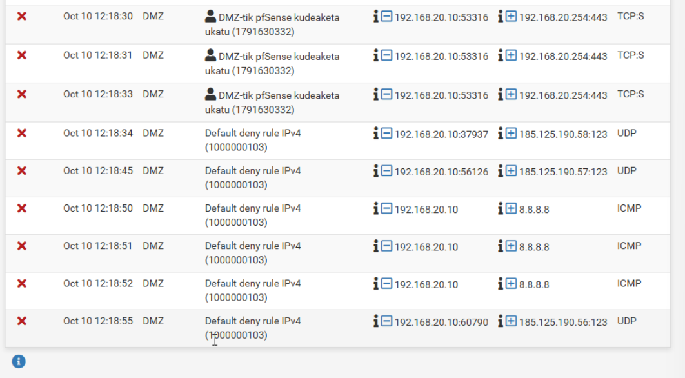
*Irudia: `curl` pfSense-ra (TCP SYN → 192.168.20.254:443) **«DMZ-tik pfSense kudeaketa ukatu»** arauak blokeatuta; ping-a 8.8.8.8-ra **Default deny rule**-ak blokeatuta. Log-ek erakusten dute zein arauk blokeatu duen paketea. ✅*

**Logetan aurkitutakoa:** www-k etengabe **UDP 123 (NTP)** bidaltzen du Interneteko denbora-zerbitzarietara (185.125.190.x = ntp.ubuntu.com) eta *Default deny*-k blokeatzen ditu → zerbitzariak ezin du ordua sinkronizatu. Ordu okerrak HTTPS ziurtagiriak eta logen datak hondatzen ditu; konponbidea: 4. araua (NTP → pfSense) eta www-n `NTP=192.168.20.254` (`/etc/systemd/timesyncd.conf`).

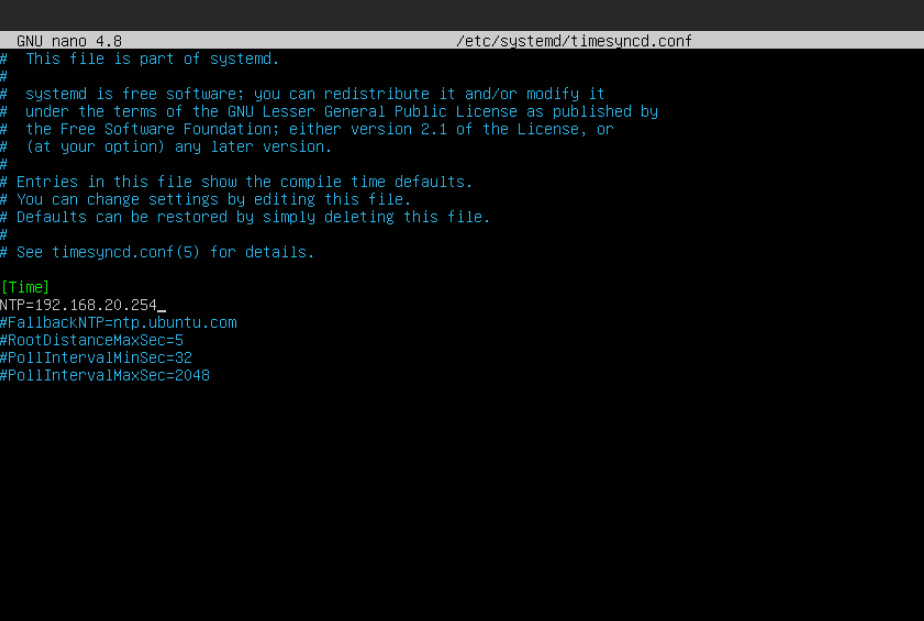
*Irudia: www-n `/etc/systemd/timesyncd.conf` → `NTP=192.168.20.254`.*

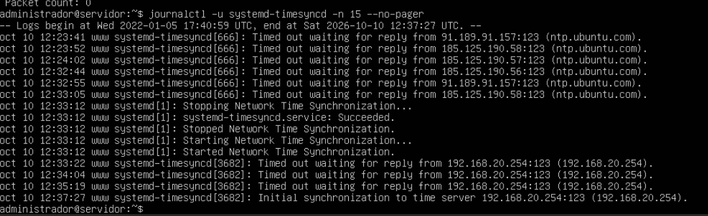
*Irudia: `journalctl -u systemd-timesyncd`: lehenik ntp.ubuntu.com-erako saiakerak (*Timed out*, suebakiak blokeatuta); gero pfSense-ra, eta arauen ordena gorde eta aplikatu ondoren: **«Initial synchronization to time server 192.168.20.254:123»**. ✅*

## Arazoak eta logak

| Arazoa | Kausa | Konponbidea |
|---|---|---|
| OPT1 ez zen kontsolako menuan agertzen IsardVDIn txartela gehitu ondoren | pfSense-k ez ditu txartel berriak automatikoki esleitzen | *1) Assign Interfaces* → vtnet2 = OPT1 |
| Kontsolan `3` sakatu zen *2) Set interface IP*-ren ordez | 3. aukera *Reset webConfigurator password* da | `n` erantzun (aldaketarik ez); `2` sakatu eta gero interfazearen zenbakia `3` |
| NTP arauaren ondoren www-k ez zuen ordua sinkronizatzen (*Packet count: 0*, *Timed out*) | Araua arrastatuz mugitu zen, baina ordena berria ez zen gorde (**Save**) ez aplikatu (**Apply Changes**); NTP araua blokeoaren azpian zegoen | Zerrendaren azpiko **Save** botoia eta gero **Apply Changes**; minutu batera sinkronizatu zen |
| 2. arauak jatorrian `! DMZ subnets` zuen | *Invert match* nahi gabe markatuta → «DMZ ez dena» | Araua editatu, *Invert match* desmarkatu. Ikasgaia: arau bakoitza sortu ondoren zerrendan berrikusi |

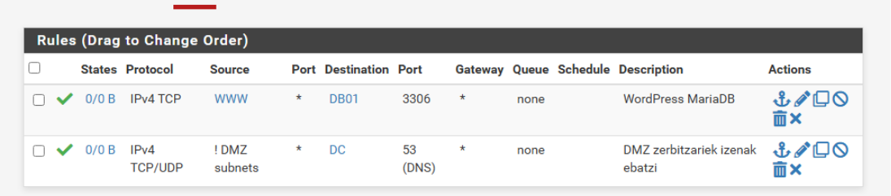
*Irudia: 2. araua zuzendu aurretik: `! DMZ subnets` (alderantzizkatuta).*
