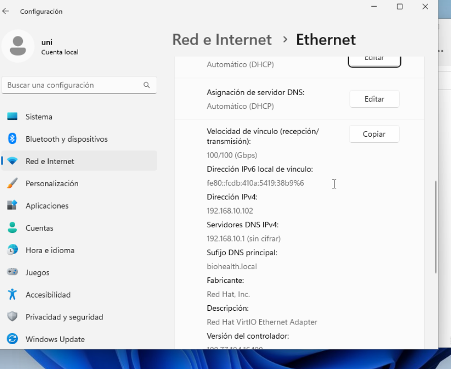

[← Hasiera](../../index.md) · [Modulua](index.md)

# DHCP

## Aukerak

| Aukera | Alde onak | Alde txarrak |
|---|---|---|
| **Windows Server DHCP** | ADn baimendua; DNS dinamikoa; erreserbak eta aukerak GUItik | Windows-en menpe |
| pfSense DHCP | Ertzean dago jada | Ez du ADrekin DNS dinamikoa egiten |
| ISC Kea (Linux) | Librea, modernoa | Zerbitzari bat gehiago |

**Erabakia: Windows Server DHCP.** pfSense-ren DHCPa desgaituta dago bi zerbitzarik gatazkarik ez izateko.

## Esparrua

| Parametroa | Balioa |
|---|---|
| Izena | Red BioHealth |
| Tartea | 192.168.10.102 – 192.168.10.200 |
| Maskara | 255.255.255.0 |
| Alokairua | 1 egun |
| 003 Router | 192.168.10.254 |
| 006 DNS | 192.168.10.1 |
| 015 Domeinua | biohealth.local |

**Tartetik kanpo (IP finkoak):** .1–.101 zerbitzari, inprimagailu eta sare-gailuentzat; .254 suebakia.

## Konfigurazio aurreratua

| Elementua | Balioa | Zergatik |
|---|---|---|
| Baimena ADn | ✅ | Baimenik gabeko DHCP zerbitzariak ez du IPrik banatzen |
| Erreserbak | Ikus [Erreserba](#erreserba) | Gailu batek beti IP bera (inprimagailuak, administrazio-ekipoak), baina DHCPtik kudeatuta |
| DNS dinamikoa | *Esparrua → Propiedades → DNS*: ☑ *Actualizar siempre dinámicamente los registros A y PTR* · ☑ *Descartar registros A y PTR cuando se elimine la concesión* | Bezeroak izenez aurkitzeko (GLPI, RDP, inprimaketa) eta IP zaharren erregistroak ez geratzeko |
| Iragazkiak (*Filtros → Permitir/Denegar*) | *(aukerakoa)* | MAC ezezagunei IPrik ez emateko (gailu arrotzak sarean) |
| Failover | Diseinua: [SB – HA](../SB-sistema-banatuak/birtualizazioa.md) (dc02, % 50/50) | DHCP zerbitzaria SPOF bat da |

## Probak

```cmd
ipconfig /release
ipconfig /renew
ipconfig /all          :: IPa .102–.200 tartean, GW .254, DNS .10.1, sufixua biohealth.local
```
Zerbitzarian: *DHCP → Esparrua → Helbideen alokairuak* → bezeroa ageri da.


*1. irudia: BEZ-WIN01 bezeroak Windows Server-eko DHCPtik jaso du konfigurazioa: IPa **192.168.10.102** (esparruaren lehena), DNS zerbitzaria **192.168.10.1** (domeinu-kontrolatzailea) eta DNS sufixua **biohealth.local** (015 aukera). ✅*

## Erreserba

| Gailua | MAC | IP erreserbatua | Zergatik |
|---|---|---|---|
| BEZ-WIN01 *(proba)* | ⏳ (argazkitik) | ⏳ | Erreserbaren funtzionamendua frogatzeko |
| Sareko inprimagailuak (produkzioan) | — | 192.168.10.50–.59 | Inprimaketa-zerbitzariaren TCP/IP atakak IP finkoa behar du |

Pausoak: *DHCP → IPv4 → Ámbito → Reservas → Nueva reserva* → izena, IPa, MAC helbidea (`ipconfig /all` → *Dirección física*), *Ambos* (DHCP eta BOOTP). Bezeroan `ipconfig /release` + `/renew` → IP erreserbatua jasotzen du.


## Arazoak eta logak

| Arazoa | Kausa | Konponbidea |
|---|---|---|
| Bi DHCP zerbitzari sare berean (arriskua) | pfSense-k LAN-en DHCP gaituta dakar lehenetsita | pfSense-ren LAN DHCP desgaitu (*Services → DHCP Server → LAN*) Windows Server-ekoa aktibatu aurretik |
| Esparrua aktibo baina bezeroak APIPA (169.254.x.x) | DHCP zerbitzaria ADn baimendu gabe | *DHCP → zerbitzaria → Autorizar* |

**Logak:** `C:\Windows\System32\dhcp\DhcpSrvLog-<eguna>.log` (ID 10 = alokairu berria, 11 = berritzea) · *Visor de eventos → Registros de aplicaciones → Microsoft → Windows → DHCP-Server*.

### Ebidentziak ⏳
- [ ] Esparruaren *Propiedades → DNS* fitxa (DNS dinamikoa)
- [ ] DNS zonan BEZ-WIN01-en A erregistroa automatikoki sortuta (ikonoa: ez da estatikoa)
- [ ] `DhcpSrvLog` fitxategia bezeroaren alokairuarekin
