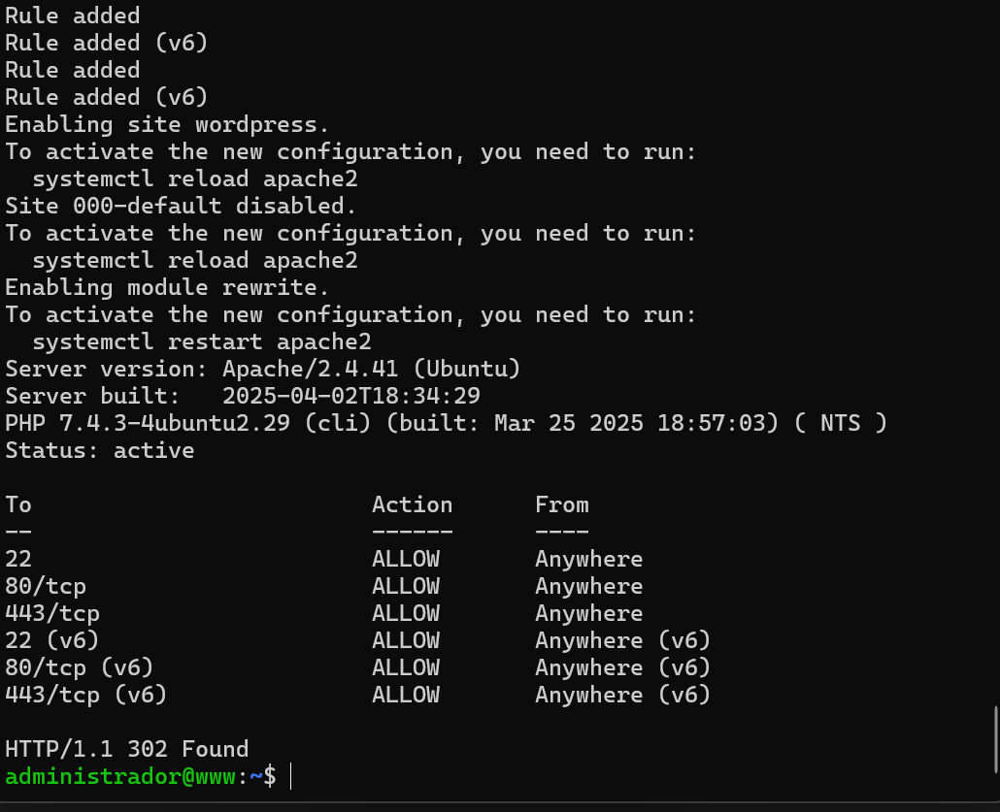
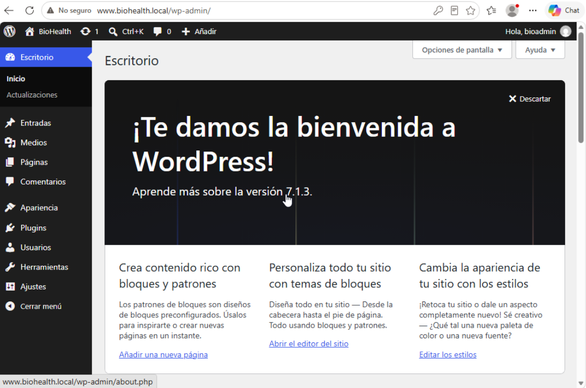
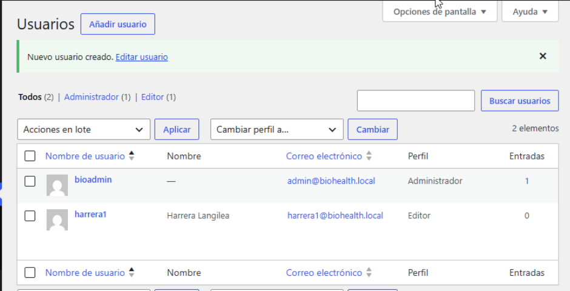
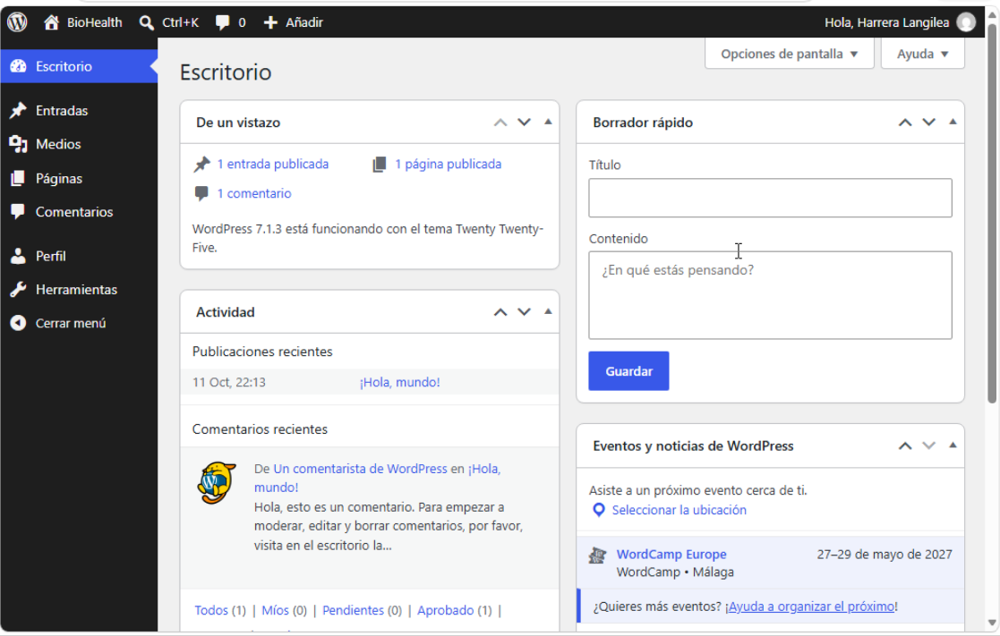
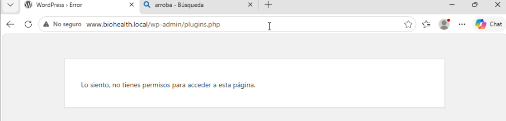
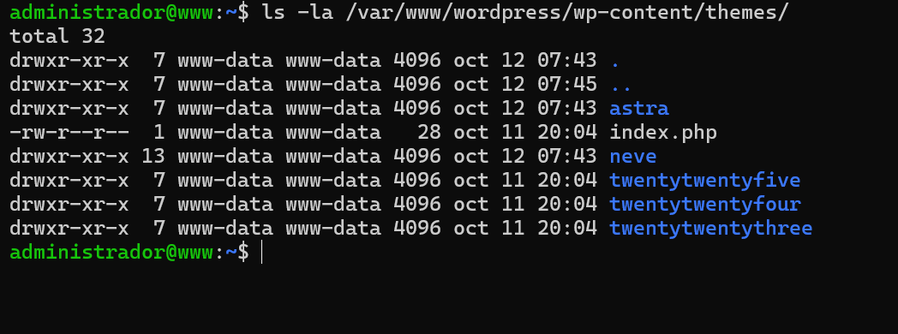
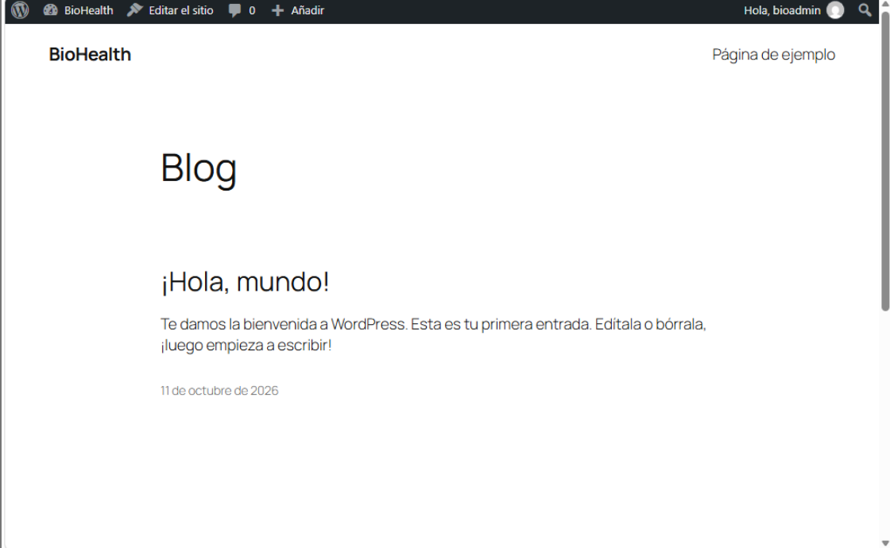
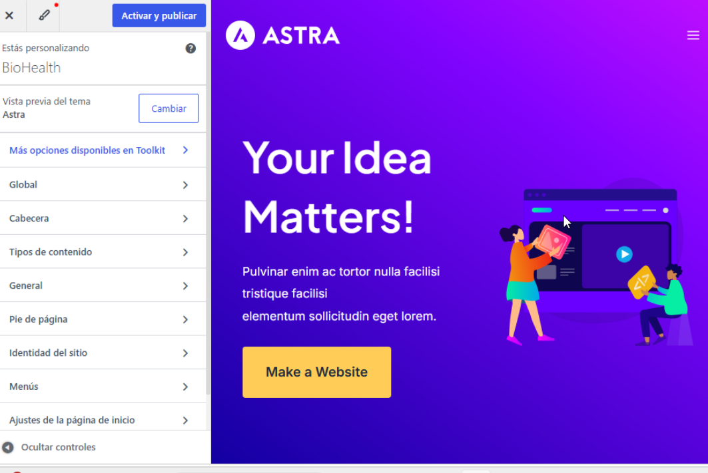
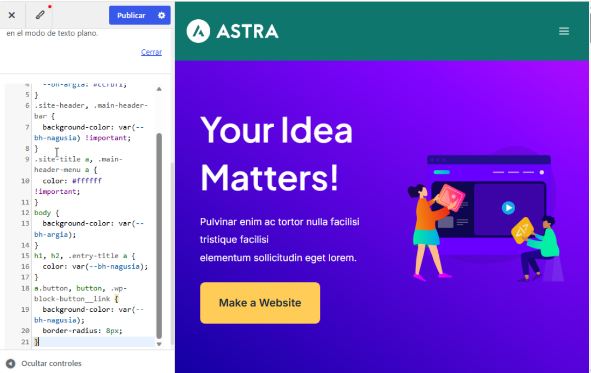

[← Hasiera](../../index.md) · [Modulua](index.md)

# WordPress – web korporatiboa

## Aukerak eta erabakia

| CMS | Lizentzia / kostua | Alde onak | Alde txarrak |
|---|---|---|---|
| **WordPress** | GPL · 0 € | Munduko CMS erabiliena (webguneen % 40+); milaka txantiloi eta plugin; erabiltzaile-rolak; ikasteko erraza; MariaDB/MySQL | Plugin askorekin eguneratu gabe utziz gero, eraso-helburu ohikoa |
| Joomla | GPL · 0 € | Malgua, rol aurreratuak | Komunitate txikiagoa, ikasteko zailagoa |
| Drupal | GPL · 0 € | Oso segurua eta indartsua | Zaila; web txiki baterako gehiegizkoa |
| Wix / Squarespace (SaaS) | Ordainpekoa (~15–30 €/hilabete) | Instalaziorik gabe | Ez da instalatzen (erronkak instalazioa eskatzen du); datuak hirugarren batean |

**Erabakia: WordPress.** BioHealth-en webgunea informatiboa da (zerbitzuak, ordutegiak, kontaktua, telekontsultarako esteka), langile ez-teknikoek eguneratu behar dute (editore-rola) eta 0 €-ko kostua du. Segurtasuna: DMZn dago, datu-basea LANean (db01), eta eguneraketak 6. arauaren bidez.

## Webaren erabilera ↔ CMSaren funtzionalitatea

| BioHealth-en beharra | WordPress-en funtzionalitatea |
|---|---|
| Kontsulta-zerbitzuak eta espezialitateak erakutsi | Orriak (Pages) |
| Albisteak / osasun-aholkuak | Sarrerak (Posts) eta kategoriak |
| Harrerako langileek edukia eguneratu | **Editor** rola (argitaratu bai, konfiguratu ez) |
| Telekontsulta | Jitsi Meet-erako esteka (`meet.biohealth.local`) |
| Irudi korporatiboa | Txantiloia + CSS pertsonalizatua |

## Instalazio-parametroak

| Parametroa | Balioa |
|---|---|
| Zerbitzaria | `www` · Ubuntu Server 20.04 · DMZ · 192.168.20.10 |
| Web zerbitzaria | Apache 2.4.41 (`mpm_prefork`, `mod_rewrite`) |
| WordPress | 7.1.3 |
| PHP | 7.4.3 (`php-mysql`, `curl`, `gd`, `mbstring`, `xml`, `zip`, `intl`) |
| VirtualHost | `/etc/apache2/sites-available/wordpress.conf` · `ServerName web.biohealth.local` · `ServerAlias` www.biohealth.local |
| DocumentRoot | `/var/www/wordpress` (jabea `www-data`) |
| Logak | `/var/log/apache2/wordpress_error.log` · `wordpress_access.log` |
| Datu-basea | `wordpress` @ db01 (192.168.10.3:3306) · erabiltzailea `wp_user` · aurrizkia `wp_` |
| ufw (www) | 22, 80/tcp, 443/tcp |
| HTTPS | ⏳ |

Instalazio-scripta: [`scripts/www-wordpress-instalazioa.sh`](https://github.com/prietosuhar/biohealth-erronka1/blob/main/scripts/www-wordpress-instalazioa.sh) — www-k GitHub-etik deskargatu eta exekutatu zuen (`wget` + `bash`).

*Irudia: scriptaren amaiera: ufw-n 80 eta 443 irekita, `wordpress` gunea gaituta eta `000-default` desgaituta, `mod_rewrite` gaituta, Apache 2.4.41 eta PHP 7.4.3. `curl http://localhost` → **HTTP/1.1 302 Found** (WordPress-ek instalatzailera birbideratzen du). ✅*

### Arazoak

| Arazoa | Kausa | Konponbidea |
|---|---|---|
| Komando-blokea SSH-n itsatsi ondoren lehen lerroa (apt) bakarrik exekutatu zen; `wordpress.conf` ez zegoen | `apt`-ek instalazioan zehar sarrera estandarra irakurri zuen eta itsatsitako gainerako lerroak «jan» zituen | Komandoak script batean jarri, GitHub-era igo eta www-n `wget` + `bash` bidez exekutatu |
| Txatetik kopiatutako `ServerAlias` lerroa Markdown esteka bihurtu zen (`[...](https://...)`) | Txat-aplikazioak domeinu-izenak esteka gisa kopiatzen ditu | Scripta GitHub-etik zuzenean deskargatuta, testua ez da aldatzen |

## Web-instalatzailea ✅

BEZ-WIN01-eko Edge-tik (LAN → DMZ, 80 portua) `www.biohealth.local` helbidera sartuta:

| Urratsa | Balioa |
|---|---|
| Hizkuntza | Español |
| Datu-basea | `wordpress` · erabiltzailea `wp_user` · zerbitzaria `192.168.10.3` · aurrizkia `wp_` |
| Gunearen izenburua | BioHealth |
| Administratzailea | `bioadmin` (ez `admin`: erasoetan probatzen den lehen izena) · pasahitz sendoa |
| Bilatzaileak | «Disuadir a los motores de búsqueda» markatuta (barneko laborategia) |

| Arazoa | Kausa | Konponbidea |
|---|---|---|
| «Error al establecer una conexión con la base de datos» | Instalatzailean datu-basearen datuak (pasahitza) gaizki idatzita | «Inténtalo de nuevo» eta datuak berriro, kontuz; `mysql -h 192.168.10.3 -u wp_user -p` komandoarekin egiaztatu daiteke |

*Irudia: `bioadmin` erabiltzailearekin administrazio-panelean (Escritorio) sartuta, BEZ-WIN01-etik `www.biohealth.local/wp-admin` helbidean. WordPress 7.1.3. ✅*

## Erabiltzaileak eta pribilegioak ✅

Pribilegio txikienaren printzipioa: administratzailea bakarra da (informatika-saila), eta harrerako langileek edukia bakarrik kudeatzen dute.

| Erabiltzailea | Rola | Nork erabiltzen du | Zer egin dezake | Zer EZ |
|---|---|---|---|---|
| `bioadmin` | **Administrator** | Informatika-saila | Dena: pluginak, txantiloiak, ezarpenak, erabiltzaileak | — |
| `harrera1` | **Editor** | Harrerako langileak | Sarrerak eta orriak sortu, editatu eta argitaratu (besteenak ere); multimedia; iruzkinak moderatu | Pluginak, txantiloiak, ezarpenak, erabiltzaileak kudeatu |

Sortzeko: *Usuarios → Añadir nuevo usuario* → izena `harrera1`, posta `harrera1@biohealth.local`, *Perfil: Editor*, «Enviar aviso al usuario» desmarkatuta (ez dago posta-zerbitzaririk).

*Irudia: bi erabiltzaile, rol desberdinekin: `bioadmin` (Administrador) eta `harrera1` (Editor). ✅*

### Probak

*Irudia: `harrera1`-ekin sartuta, menua mugatuta dago: Entradas, Medios, Páginas, Comentarios, Perfil eta Herramientas bakarrik. Ez dira agertzen **Apariencia, Plugins, Usuarios eta Ajustes**. ✅*

*Irudia: ukatze-proba: `harrera1`-ek `/wp-admin/plugins.php` helbidea zuzenean idatzita → «Lo siento, no tienes permisos para acceder a esta página». Menua ezkutatzeaz gain, WordPress-ek zerbitzarian egiaztatzen ditu baimenak. ❌ (espero zena)*

## Txantiloiak ✅

Hiru txantiloi probatu dira, *Apariencia → Temas → Vista previa en vivo* erabiliz (aktibatu gabe, webgunea aldatu gabe). Astra eta Neve *Añadir tema* bidez instalatu dira wordpress.org-etik: www-k Internetera irten daiteke pfSense-ko 6. arauari esker (eguneraketak, HTTP/HTTPS).

*Irudia: txantiloiak `/var/www/wordpress/wp-content/themes/` karpetan instalatzen dira, `www-data` jabearekin. ✅*

| | Twenty Twenty-Five | Astra | Neve |
|---|---|---|---|
| Mota | Bloke-txantiloia (FSE) | Klasikoa + Personalizadorea | Klasikoa + Personalizadorea |
| Egilea | WordPress (ofiziala) | Brainstorm Force | Themeisle |
| Instalazio aktiboak | Lehenetsia | 1.000.000+ (erabiliena) | 300.000+ |
| Pisua / abiadura | Oso arina | Oso arina (< 50 KB) | Oso arina |
| Mugikorra (responsive) | Bai | Bai | Bai |
| Pertsonalizazioa | *Editor del sitio* (blokeak) | Personalizadorea: koloreak, tipografia, goiburua, oina, **CSS adicional** | Personalizadorea, aukera gutxiago |
| Langile ez-teknikoentzat | Zailagoa (gune-editorea) | Erraza | Erraza |

*Irudia: Twenty Twenty-Five (aktiboa): minimalista, testua bakarrik; itxura «blog» bat da, ez osasun-zentro batena.*

*Irudia: Astra aurrebistan: Personalizadorearen menua (Global, Cabecera, Pie de página, Identidad del sitio...).*

*Irudia: Neve aurrebistan: Astraren antzekoa, baina aukera gutxiago.*

**Erabakia: Astra.**
- **Errendimendua:** txantiloi arinenetakoa, garrantzitsua IsardVDI-ko baliabide mugatuetan.
- **Mantentzea eta segurtasuna:** erabiliena da, maiz eguneratzen da eta komunitate handia du (akatsak azkar konpontzen dira).
- **Erabilgarritasuna:** Personalizadorea erraza da; harrerako langileek (Editor) ez dute gune-editorerik ukitu behar.
- **CSS:** *CSS adicional* atala zuzenean dago, BioHealth-en kolore korporatiboak aplikatzeko (hurrengo atala).

*Irudia: «Nuevo tema activado» → **Activo: Astra**. ✅*

- Twenty Twenty-Five baztertuta: bloke-editorea indartsua da baina konplexuagoa; Neve baztertuta: Astraren antzekoa, aukera eta komunitate txikiagoarekin.

## Diseinua eta CSS aldaketak ✅

**Helburua:** webgunea BioHealth-en irudi korporatibora egokitzea. Osasun-sektorean ohikoak diren kolore **berde-urdinxkak** aukeratu dira (lasaitasuna, garbitasuna, konfiantza), Astraren lehenetsitako more/urdinaren ordez.

**Non:** *Apariencia → Personalizar → CSS adicional*. CSSa datu-basean gordetzen da (`wp_posts`, `custom_css` mota), eta ez da txantiloiaren fitxategietan idazten: **Astra eguneratzean ez da galtzen**, eta ez da *child theme* bat behar.

Kodea: [`scripts/biohealth.css`](https://github.com/prietosuhar/biohealth-erronka1/blob/main/scripts/biohealth.css)

| Hautatzailea | Aldaketa | Zergatik |
|---|---|---|
| `:root` | `--bh-nagusia: #0f766e` · `--bh-argia: #ccfbf1` | CSS aldagaiak: kolorea leku bakarrean aldatuta, gune osoan aldatzen da |
| `.site-header`, `.main-header-bar` | Atzeko planoa berde-urdina | Goiburua, markaren elementu ikusgarriena |
| `.site-title a`, `.main-header-menu a` | Testu zuria | Kontrastea (irisgarritasuna, WCAG) |
| `body` | Atzeko plano berde argia | Kolore korporatiboa orrialde osoan |
| `h1`, `h2`, `.entry-title a` | Izenburuak kolore nagusiarekin | Koherentzia |
| Botoiak | Kolore nagusia + `border-radius: 8px` | Itxura modernoa eta koherentea |

`!important` goiburuan bakarrik erabiltzen da, Astrak bere estiloak inline gehitzen dituelako.

*Irudia: CSS adicional atalean kodea itsatsita; aurrebistan goiburua dagoeneko berde-urdina da.*

*Irudia: argitaratu ondoren, `www.biohealth.local`: goiburua kolore korporatiboarekin (lehen morea). ✅*

### Arazoak

| Arazoa | Kausa | Konponbidea |
|---|---|---|
| Ezin da CSSa ordenagailutik BEZ-WIN01-era itsatsi | IsardVDI-ko makinak ez du ostalariaren arbela partekatzen | CSSa GitHub-era igo; BEZ-WIN01-eko Edge-n `raw.githubusercontent.com/...` ireki, Ctrl+A / Ctrl+C eta makinaren barruan itsatsi |
| Argitaratzean Astraren adibide-edukia agertu zen (menua, «Your Idea Matters») | WordPress-en *starter content*: gune berri batean Personalizadorean lehen aldiz argitaratzean, txantiloiaren adibide-orriak sortzen dira | BioHealth-en edukiarekin ordezkatu |
